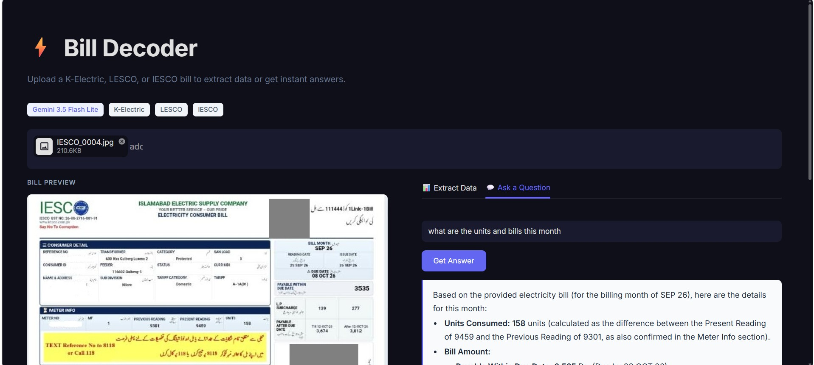
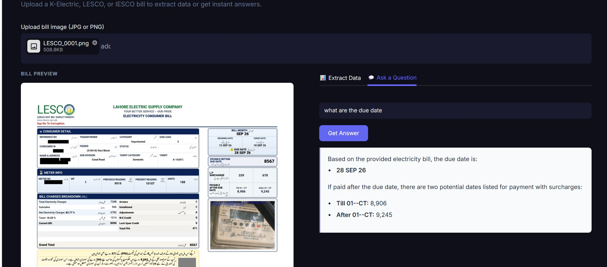

# ⚡ AI Utility Bill Decoder

### WomenTechQuest Build Track — Hackathon Submission

> An AI‑powered tool that reads Pakistani electricity bills (K‑Electric, LESCO, IESCO) and extracts structured data or answers natural‑language questions — all powered by Google Gemini 3.5 Flash Lite.





---

## 🚀 Features

| Feature | Description |
|---|---|
| 📊 **Level 1: Bill Extraction** | Extracts billing details, charges, taxes, and readings into structured JSON |
| 💬 **Level 2: Bill QA** | Answers natural‑language questions grounded strictly in the bill |
| 🖥️ **Streamlit UI** | Clean, reusable, login‑free web app for live demo |
| ✅ **File Validation** | Only JPG/PNG allowed, max 5 MB enforced |
| 🔑 **Secure API Key** | Gemini API key loaded from Streamlit secrets or `.env` (never hard‑coded) |

---

## 🗂️ Project Structure

```
your‑submission/
├── source/
│   ├── extract.py          # Level 1: Bill extraction script
│   ├── answer.py           # Level 2: Question answering script
│   ├── app.py              # Streamlit web UI (login‑free)
│   ├── gemini_client.py    # Shared Gemini model helper
│   ├── prompts.py          # Extraction & QA prompts
│   ├── requirements.txt    # Python dependencies
│   ├── .env.example        # API key template (safe to share)
│   └── .streamlit/
│       ├── secrets.toml    # Gemini API key (and optional config)
│       └── config.toml     # UI theme settings
├── output/
│   ├── level1.csv          # Extracted bill data (JSON per bill)
│   └── level2.csv          # Answered questions per bill
└── test/csv/level2.csv     # Test question template
```

---

## ⚙️ Setup

**Requirements:** Python 3.11+

```bash
pip install -r requirements.txt
```

Copy the environment template and add your Gemini API key:

```bash
cp .env.example .env
# Then edit .env and set API_KEY=your_key_here
```

---

## 📊 Running Level 1 — Bill Extraction

```bash
python extract.py
```

Output: `../output/level1.csv` — one row per bill, with a JSON object containing all extracted fields.

---

## 💬 Running Level 2 — Bill QA

```bash
python answer.py
```

Place the test template at `../test/csv/level2.csv` before running.  
Output: `../output/level2.csv` — same rows with the `answer` column filled in.

---

## 🖥️ Running the Web UI

```bash
streamlit run app.py
```

Open **http://localhost:8501** in your browser. No login is required.

---

## 🤖 AI Usage Declaration

| Category | Tool / Service Used |
|---|---|
| **Models Used** | Gemini 3.5 Flash-Lite (`gemini-3.5-flash-lite`) |
| **APIs / Cloud Services** | Google AI Studio (Gemini API) |
| **AI Coding Assistants** | Google Antigravity IDE |
| **Other AI Tools** | None |
| **OCR / Prebuilt Extraction Services** | None (complies strictly with rules) |

---

## 📦 Python Dependencies

| Package | Version | Purpose |
|---|---|---|
| `google-generativeai` | 0.8.3 | Gemini API client |
| `pillow` | 10.4.0 | Image loading |
| `python-dotenv` | 1.0.1 | Environment variable management |
| `streamlit` | 1.38.0+ | Web UI framework |
